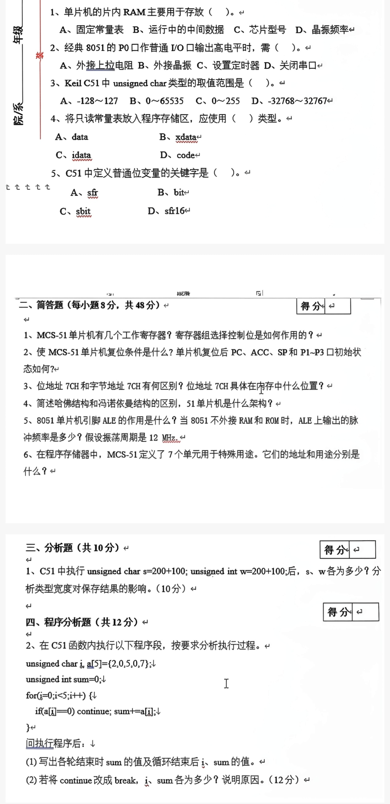

# 2026-2027 第一学期单片机原理期中试卷（部分）

> [!NOTE]
>
> 2026-2027 学年第一学期集成电路学院《单片机原理》期中试卷部分内容，仅包含原题与试卷原图（内容并不完整）。感谢热心同学投稿分享！

## 一、选择题（部分）

1. 单片机的片内 RAM 主要用于存放（ ）。
   - A、固定常量表
   - B、运行中的中间数据
   - C、芯片型号
   - D、晶振频率

2. 经典 8051 的 P0 口作普通 I/O 口输出高电平时，需（ ）。
   - A、外接上拉电阻
   - B、外接晶振
   - C、设置定时器
   - D、关闭串口

3. Keil C51 中 `unsigned char` 类型的取值范围是（ ）。
   - A、-128~127
   - B、0~65535
   - C、0~255
   - D、-32768~32767

4. 将只读常量表放入程序存储区，应使用（ ）类型。
   - A、data
   - B、xdata
   - C、idata
   - D、code

5. C51 中定义普通位变量的关键字是（ ）。
   - A、sfr
   - B、bit
   - C、sbit
   - D、sfr16

## 二、简答题（每小题 8 分，共 48 分）

1. MCS-51 单片机有几个工作寄存器？寄存器组选择控制位是如何作用的？
2. 使 MCS-51 单片机复位条件是什么？单片机复位后 PC、ACC、SP 和 P1~P3 口初始状态如何？
3. 位地址 7CH 和字节地址 7CH 有何区别？位地址 7CH 具体在内存中什么位置？
4. 简述哈佛结构和冯诺依曼结构的区别，51 单片机是什么架构？
5. 8051 单片机引脚 ALE 的作用是什么？当 8051 不外接 RAM 和 ROM 时，ALE 上输出的脉冲频率是多少？假设振荡周期是 12 MHz。
6. 在程序存储器中，MCS-51 定义了 7 个单元用于特殊用途。它们的地址和用途分别是什么？

## 三、分析题（共 10 分）

1. C51 中执行 `unsigned char s=200+100; unsigned int w=200+100;` 后，s、w 各为多少？分析类型宽度对保存结果的影响。（10 分）

## 四、程序分析题（共 12 分）

2\. 在 C51 函数内执行以下程序段，按要求分析执行过程。

```c
unsigned char i, a[5]={2,0,5,0,7};
unsigned int sum=0;
for(i=0;i<5;i++) {
    if(a[i]==0) continue; sum+=a[i];
}
```

问执行程序后：

（1）写出各轮结束时 `sum` 的值及循环结束后 `i`、`sum` 的值。

（2）若将 `continue` 改成 `break`，`i`、`sum` 各为多少？说明原因。（12 分）

## 附：试卷原图


